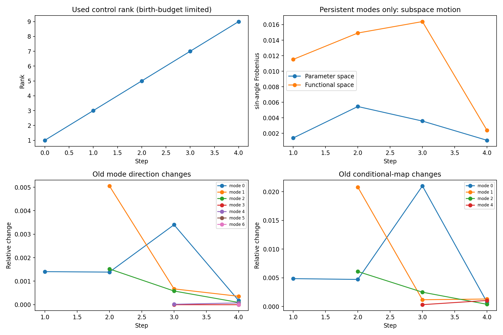
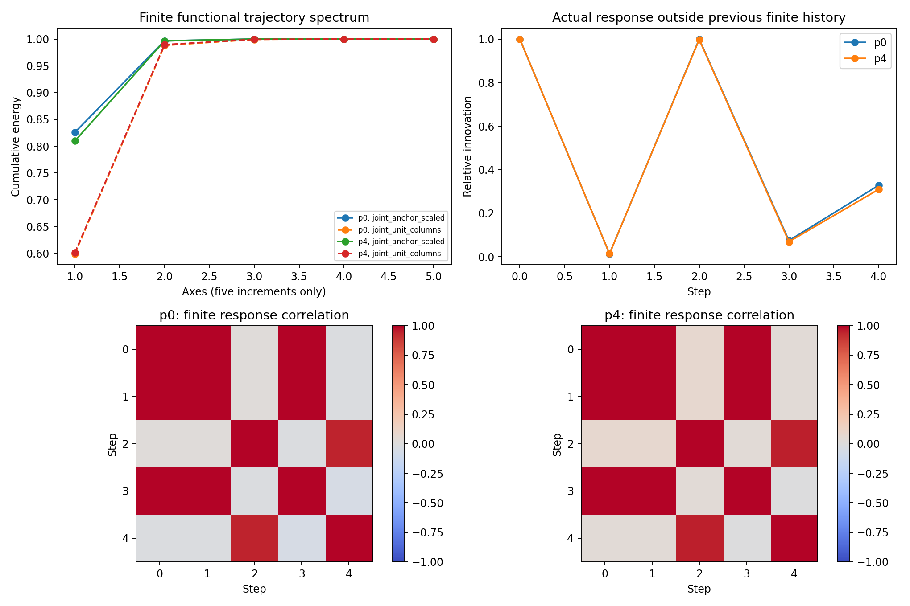
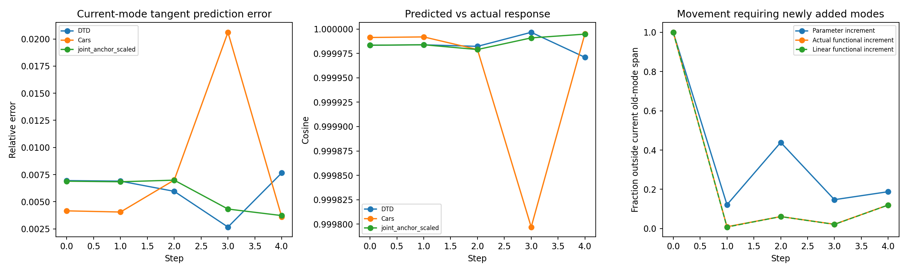

# 锚点0：低维控制与实际功能共同演化诊断

本轮没有新seed、训练、304列刷新、模式出生或参数写回。读取五个已接受检查点，模式对齐本次更新前位置；实际增量从原记录恢复并以固定点前向核对。仅请求已有模式上的50次任务级JVP，命中此前已验证缓存则直接复用。

控制秩为[1, 3, 5, 7, 9]；实际参数增量在所用模式空间中的最大相对残差为2.16e-14。旧模式最大方向变化为0.5055%，最大条件映射相对变化为2.1006%；已有支持是否全部不变：True。

## 切向响应是否解释真实变化

| 步骤 | 秩 | 联合响应相对误差 | 方向余弦 | 实际功能增量在旧模式响应空间之外的比例 |
|---|---:|---:|---:|---:|
|0|1|0.6893%|0.999983|100.0000%|
|1|3|0.6842%|0.999984|0.9497%|
|2|5|0.6988%|0.999979|6.1177%|
|3|7|0.4329%|0.999991|2.2038%|
|4|9|0.3726%|0.999995|12.0248%|

联合响应先按初始锚点的两任务Jacobian Frobenius范数固定缩放再拼接；缩放常数对全部时刻和p4保持一致。原始不缩放谱、单任务谱以及逐列单位化的方向谱同时保留，避免将任务尺度或大步长造成的能量集中误认为普遍低维。实际功能增量的旧空间外分量也可能含非线性误差，需与参数增量和线性预测的旧空间外比例一起判断，不能全部归因于新模式。

## 实际轨迹谱

| 探针 | 第一轴能量 | 前两轴能量 | 谱参与率 |
|---|---:|---:|---:|
|p0|82.5824%|99.6569%|1.4062|
|p4|80.9824%|99.6534%|1.4478|

只有五个实际时间增量，轨迹矩阵秩上界天然为5。这些谱仅描述该条短轨迹，不能证明稳定内在维数或跨seed规律。p4只重新测量有限变化，没有额外计算p4模式Jacobian。p4此前已使用，是探索性稳定性检查，不是新盲测。

r2记录的有历史/无历史反事实中，改变出生选择的次数为0。历史确实进入过算法，不等于已经产生了额外结构选择价值。

## 判断边界

若参数张成残差和切向解释误差很小，支持当前控制模式持续承担并解释了真实更新。非零旧模式漂移、出生后出现独立功能分量，可作为本轨迹的动态结构迹象；但新模式加入本身不能证明旧模式重整必要。秩1→3→5→7→9受出生速率与步数预算限制，不能称为九维收敛流形。冻结/重整/出生的必要性反事实已暂停，尚不作因果结论。完整参数域仍为304维专家重组空间，未验证完整86M参数内在维数。

## 图

