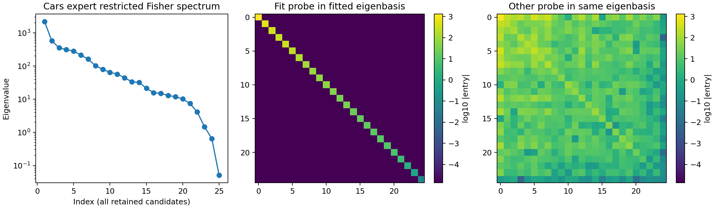
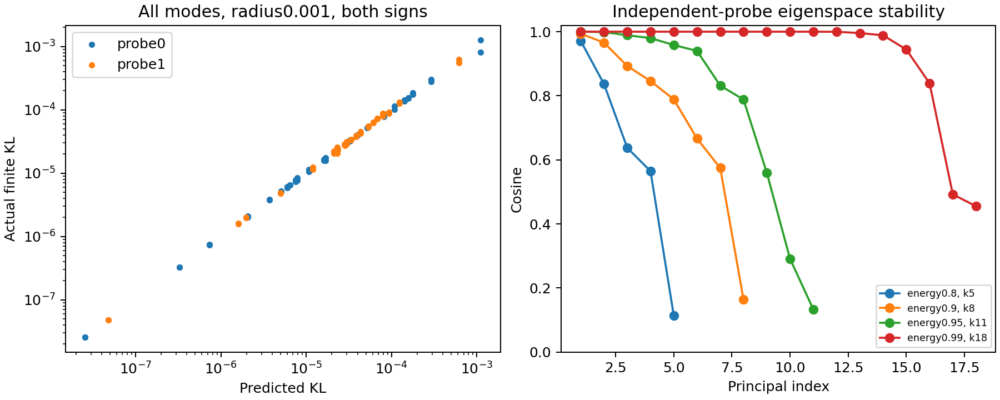

# Cars Fisher 子空间谱与对角化

2026-11-14，A100完成。复用 Cars adaptive_dynamics 已训练专家和保存的学习结构，不重新训练，不使用旧 DTD v5 十维，不做 Support Profile、leverage、掩码或 EC。

## 可直接复用的模型与结构

Cars 专家：`EXPERTS8_FD_REVIEWED_20261110/Cars/adaptive_dynamics/epoch08.pt`。历史87.08%，本次锁定 Test 复现 **87.0787%**（7002/8041），CE 0.483592。Test只核验锁定权重，不参与方向/阈值选择。
保存8个分量、16个坐标，每组3条非线性载体轴。原训练上限为8组，已碰上限；这些数目不是自然 Fisher 维数。实际坐标切空间数值秩为16。
完整解码相对专家终点位移误差为1.111615，所以专家精度不能当作载体独立承担训练的证明。DTD约82.07%的同框架结构可用；81.86%是不同的adaptive_allocation版本，仅找到归档指标，未找到其检查点，不能混同。

## Fisher 协议

全视觉端 D=86,192,640，不是旧48矩阵范围。候选包括保存的全部载体轴、实际专家位移和保存的 frozen-decoder 位移；FP64两遍重正交化，相对1e-5/绝对1e-12阈值，保留 **25维**，未设维数上限。该维数是候选范围的数值秩，不是完整 Cars Fisher 的天然维数。
固定预测嵌入 q=2sqrt(p)/sqrt(N)，两批互不重叠训练侧图各128张。专家曾在全部8144张上训练；两批只是本次探测划分分离，不是模型从未见过的数据。逐列真实 JVP 计算 R=JQ，再构造 A=R^T R。
三锚点是预训练基座、已保存 frozen-decoder 模型、完整专家；它们不是历史训练轨迹。专家主结果用当前专家锚点，另外两者仅用于变化检查。共同分块拟合基座/专家的第一批，decoder锚点和第二批作为留出检查；不能称为时间共同不变结构或跨任务验证。

## 实际谱与对角化

数值有效秩（最大特征值的1e-6）为25；参与率秩3.8211；熵秩6.9236。解释80/90/95/99%受限 Fisher迹需要的维数分别为 5, 8, 11, 18。
拟合矩阵在自身特征基中的非对角 Frobenius 比为7.71e-16，这是代数性质。另一批图在同一基中为 **0.6410**；后者才提供重现性检查。独立子空间余弦见 validation_audit.json，不能把近重根的单向量旋转直接判成子空间失败。

单独限制到真正的已学坐标切空间（16维），其Fisher数值有效秩为16，参与率秩2.9954；解释80/90/95/99%迹所需维数为 4, 6, 8, 12。该切空间拟合特征基在另一批图的非对角比为0.5554。它与25维候选矩阵必须区分。

多模型锚点共同块候选大小为[1, 22, 1, 1]。按原DTD的严格标准：全局块外泄漏≤5%、归一化块对耦合≤10%，留出验收结果为 **False**。本审计补上块对判据；原始运行器blocks.json的held_support只包含全局泄漏，不作为最终验收。

## 真实有限扰动

对全部拟合特征方向施加±0.001、±0.003的单位参数范数扰动，直接测两批真实预测 KL 和 CE变化。比较 epsilon² v^T Fv /2。没有优化方向或坐标，没有将 Fisher 能量解释成任务冲突。
radius0.001且预测KL>1e-9的实际/预测比值分位数（min/10%/median/90%/max）为 [0.7403009560803265, 0.9610748687409411, 1.0073709474998074, 1.0597811991239563, 1.140637663249907]。弱响应模式的数值精度与有限步长非线性需分别看，完整逐模式记录保留。

## 溯源与边界

公开原始/对角化/共同旋转矩阵NPZ、CSV、谱、全部有限扰动和源哈希。Q与完整模型权重留在A100 private/。每个响应缓存及有限模式记录可复用；本轮未做硬中断恢复验收。
输出 `/media/shangxueyuan/data1/Cars_fisher_diagonalization_20261114`。源码和分块求解器哈希见config；归一化、参数次序和两批ID均明确记录。
本轮交付 Cars 的受限 Fisher 子空间对角化。没有进行 DTD–Cars 共同锚点交叉测量，也没有认定真实负迁移；后续跨任务实验需另行在同一锚点重算两任务的 Fisher。
