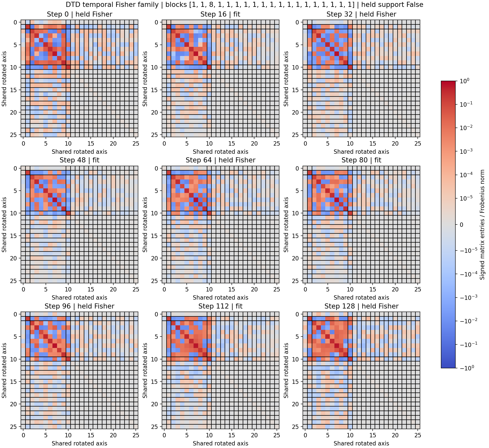

# DTD 单任务时间算子族：分块检验

实际计算空间维度为 **26**，没有固定维度上限。候选包含所有17个保存状态的字典方向与16个实际轨迹增量；完整终点位移优先入基，数值相关方向由 FP64 两遍重正交化识别。

分析载体是已完成的 v5 DTD128步中程轨迹，活动范围为48个视觉权重矩阵，**并非已经收敛的完整专家**。第49步刷新失败的另一条全视觉轨迹未被冒充为完成轨迹。

## 实测结果

- 同一参数坐标 Q 上提取9个训练状态的 Fisher，每个状态分别使用固定128张探测图与另一组不重叠的128张训练来源探测图；没有混入其他任务算子。
- 候选块大小：`[1, 1, 8, 1, 1, 1, 1, 1, 1, 1, 1, 1, 1, 1, 1, 1, 1, 1, 1]`。是否存在非平凡候选：`True`；预先规定的留出验收是否支持：`False`。
- 拟合状态的整体块间泄漏：`[0.03532406117749266, 0.01788274616399196, 0.024875680651007342, 0.04308079790626562]`。
- 留出状态的整体块间泄漏：`[0.07401005125695662, 0.03866232713878481, 0.02857478318819623, 0.0296473686968413, 0.05678922855408189]`。
- 另一探测集的整体块间泄漏：`[0.1383746185783097, 0.11934213442698784, 0.12062174041244482, 0.13046103619018432, 0.13626545428095574, 0.13616517459161084, 0.13895652651517526, 0.17493654974744322, 0.17799389025735976]`。
- 留出状态归一化块对耦合：`[0.21116582688212807, 0.2033222589753189, 0.21712376413468712, 0.22667605535376972, 0.22856515654032453]`；另一探测集：`[0.20791201037827728, 0.18405832509195835, 0.20794854319004766, 0.2139835006015128, 0.21840336993542084, 0.2156466699941182, 0.24348715763355222, 0.21007168925387526, 0.1950962435681699]`。
- 各组终点更新能量比例：`[3.591379069138941e-08, 3.852606659750655e-05, 0.960003614479472, 0.03995627021762489, 1.3470668615716375e-07, 8.705354346496386e-08, 1.7934675627662758e-07, 9.014007562403507e-08, 1.5152721019105442e-07, 1.997701463982915e-10, 2.5335101478277147e-07, 1.0014412078375845e-07, 2.5973002658567505e-07, 2.8771485606007733e-08, 2.1050641149838068e-11, 2.8482593302401483e-09, 2.3528888043353105e-07, 2.9805452499619234e-08, 4.783489023127324e-10]`。
- 完整剩余位移范数 5.92421e-12；终点更新范数 0.126364；包含残差后的重构误差 7.0881e-17。

当前候选搜索没有建立多个稳定块的证据。一个整体块是合法结果；不能仅为了 EC 人为拆组，也不能把此结果解读为任何方法都不可能发现结构。

图中保留真实有符号的非对角项，仅为显示按各矩阵 Frobenius 范数归一化。没有将块间条目置零。每个状态的 raw_fisher_step_*.csv、block_matrix_step_*.csv，以及 [block_matrices.npz](block_matrices.npz)保存未显示归一化的实际数值、同一旋转和分块标签。

## 定义与验收

矩阵为 `A_t=(D_theta[2sqrt(p)/sqrt(N)] Q)^T(D_theta[2sqrt(p)/sqrt(N)] Q)`，即 `Q^T F_D,t Q`。公共坐标固定，不能用每个状态自己的特征基分别对角化再声称存在共同结构。

仅16、48、80、112步的 Fisher 参与近似交换子拟合及分块选择。对其余状态和另一探测集使用同一个分块验收。整体泄漏5%、归一化块对耦合10%为预先设置的经验阈值，完整值及100次同块大小随机旋转控制保存在 [results.json](results.json)。单个拟合状态的特征基在其他状态上的非对角残差也另存于 [update_allocation_and_controls.json](update_allocation_and_controls.json)。

共同Q使用了全条已知轨迹，因此这只是条件于共享计算空间的留出 Fisher 检验，不是对全新训练轨迹的泛化证明。`Q^T F Q` 中解耦不保证 F 在 Q 外的作用为零；本轮未穷尽测量全参数空间不变性。

## 完整位移保留

每个候选组用 `Q O_m O_m^T Q^T tau` 定义，不能覆盖的部分全部保存为高维 residual。大文件留在 A100 `/media/shangxueyuan/data1/DTD_fisher_blocks_expanded_20261113`：`common_basis.pt` 与 `complete_update_decomposition.pt`。后者还保存原始完整 tau；没有丢弃小残差，也没有把组定义为某一层。

跨48个权重矩阵的更新能量分配见控制 JSON。这是描述性分配，不是删除组或真实 CE 干预后的因果功能归因。Fisher 块间项也不等于任务损失冲突；后续跨任务交互应保留其符号和幅度，另由双任务性能与 EC 搜索研究。

方法及适用边界见 [代码说明](../../README.md)。没有使用官方测试集。
