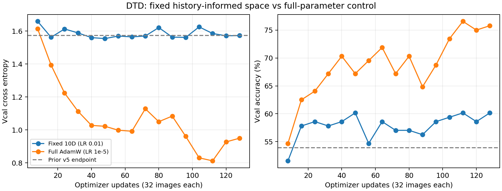

# DTD 固定 10 维空间：投影重建与受限训练

2026-11-13，A100 实测完成。两条训练各完成 128 次更新，进程正常退出（状态 0）。不运行 Grassmann，不重新分组，不进行纤维修正。官方测试集未打开。

## 固定空间的确切定义

复用上一实验的 26 维欧氏正交参数基 Q。对先前 DTD 轨迹第 16、48、80、112 步的四个投影 Fisher 分别做 Frobenius 范数归一化，再求平均矩阵的最大十个特征向量 W。参数基为 B10=QW，B10^T B10≈I；整个新实验中 B10 固定。

Q 的构造使用了先前完整轨迹、字典以及终点位移。因此本实验是**使用历史信息的固定空间容量对照**，不能作为在线结构发现算法，也不能据此宣称 DTD 的内在维度为十维。特别是终点位移本身参与 Q 的构造，投影覆盖率不是独立发现能力的证据。

活动范围为原轨迹的 48 个视觉权重矩阵，共 84,934,656 个参数；其余参数及分类头固定。训练池 2096 张；固定探测集 X 为 128 张，Vcal 为 128 张，独立开发集 Xprime 为 512 张。逐步审计确认实际优化样本未进入这些探测/开发集合。

## 一、终点投影重建

对原第 128 步的实际 FP32 参数位移做 FP64 欧氏正交投影，再实化为 FP32 模型。原模型和投影模型在相同后端及完全相同的样本上成对测量。

保留位移欧氏平方范数 **99.9998364212%**；残差范数 **0.00016162123**。

| 开发集合 | 原模型准确率 | 投影准确率 | 原 CE | 投影 CE | 类别预测一致率 |
|---|---:|---:|---:|---:|---:|
| Vcal，128 张 | 53.90625% | 53.90625% | 1.5736011770 | 1.5736008798 | 100% |
| Xprime，512 张 | 51.171875% | 51.171875% | 1.7394549627 | 1.7394553610 | 100% |

平均 KL 分别为 1.2833e-11、1.3505e-11。这里的结论是：这个固定 10 维空间几乎无损保留了**这条已有轨迹终点**的预测性能。CE 应使用本次成对测量值，不能与历史后端下的微小数值差异混比。

## 二、从相同起点重新训练

两条新训练都从 theta0 出发、没有预热，每步 32 张、共 128 步，实际样本 ID、顺序和确定性的增强采样规则相同。10D 从十个零坐标开始，只更新坐标，完整模型始终由 theta0+B10*a 生成；全参数对照允许活动范围内所有参数变化。

两者均用 AdamW、权重衰减 0。预先指定 10D 坐标学习率 0.01，全参数学习率 1e-5；没有做学习率搜索。这是相同样本与更新次数的对照，不是相同学习率、相同计算量或已优化超参数的比较。起点 Vcal 准确率为 45.3125%，CE 为 1.93730950。

| 模型状态 | 步数 | Vcal 准确率 | Vcal CE | Xprime 准确率 | Xprime CE |
|---|---:|---:|---:|---:|---:|
| 10D，最终 | 128 | 60.15625% | 1.57264578 | 51.5625% | 1.73168850 |
| 10D，Vcal CE 选出 | 48 | 60.15625% | 1.55455828 | 51.3671875% | 1.72582769 |
| 全参数 AdamW，最终 | 128 | 75.78125% | 0.94960022 | 72.265625% | 1.04620624 |
| 全参数 AdamW，Vcal CE 选出 | 112 | 76.5625% | 0.81198752 | 73.828125% | 0.96889943 |

选模仅使用每 8 步的 Vcal CE；Xprime 不参与选模。图中只显示 Vcal 轨迹：

受限训练达到了接近原 v5 终点的独立开发性能，但明显低于本次全参数对照。这支持“固定十维可以承载这条历史轨迹附近的有效学习”，**不支持“十维已经保留了全参数训练潜力”**。这里只考察一组预先指定的优化配置，差距还不能单独证明空间容量不足；需要更充分优化或其他固定空间对照才能区分容量与优化因素。也不应把两条新训练的差距直接归因于 Fisher 几何。

## 检查点与溯源

A100 输出目录：`/media/shangxueyuan/data1/DTD_fixed10_20261113`。冻结执行源码：`/home/shangxueyuan/merging/tsv/scripts/dtd_fixed10_20261113/run.py`，SHA256 为 `04ff615e0d2e3f2bdb672b92607f49a16619d280cbb304c8b4108e56a236f6a9`，与提交中的 run.py 字节一致。

每条训练的第 8、16、…、128 步均保留完整可恢复状态，共 32 个检查点。固定大基底单独保存在同一输出目录，坐标检查点引用它；全参数检查点包含参数与 Adam 状态。只读审计确认各检查点步数、优化器步数、历史记录和身份一致，selected.pt 与被选中步数的状态一致。本轮**没有进行实际中断后重放测试**，不能把元数据核验等同于恢复验收。

公开的是代码、汇总 JSON、逐步样本 ID 与图。完整基底和模型检查点保留在服务器。`assets.json` 原样记录冻结 ClipTask 适配器的初始化元数据，其中 `algorithm`、`parameter_state`、`expert_endpoints_read` 不是本实验协议的声明；本实验确实读取历史 Fisher 和终点，请以 `config.json`、`projection.json`、`effective_protocol.json` 为准。

复核：本地运行 `python scripts/dtd_fixed10/test_fixed.py`（2 项投影/链式梯度测试）和 `python scripts/dtd_fixed10/summarize.py`（记录配对、集合隔离、执行源码哈希核验及出图）。A100 上运行 `audit_checkpoints.py OUTPUT` 检查实际保存的完整状态；本次结果见 checkpoint_audit.json。
