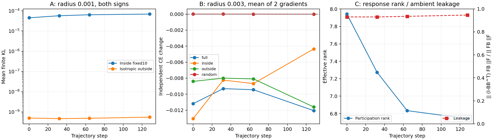

# 固定 Fisher 十维的 A / B / C 机制验证

2026-11-13，A100 完成，服务 `dtd-fixed10-mechanisms-20261113.service` 正常退出（0）。没有优化器、没有连续训练、没有基底更新或系数拟合。原轨迹检查点与十维基底只读。

这次结果支持两件事：**十维在独立图像上具有可复现的局部预测敏感性，并包含能降低独立 CE 的方向**。同时，**它没有表现为 Fisher 在整个活动参数空间中的近似封闭不变子空间**。响应内部度量随状态发生变化；没有足够状态验证其预测后续收益的能力。

## 固定协议与独立性

- B 与前两项投影实验完全相同，读取 `DTD_fixed10_20261113/fixed_basis.pt`。只分析它，不构造新的学习空间，也不重新分组。
- 观察旧 v5 第 0、32、64、128 步。B 来自完整旧轨迹，故这些结果是回顾性机制实验，不是早期发现对未来的前瞻验证。
- A/C 使用独立开发集 Xprime 的前 128 张；这批样本没有参与 B 的方向选择。B 使用完整 Xprime512 做独立 CE 检查，梯度来自两批互不相交的训练侧图像，各 64 张。样本 ID 均记录在 config.json。
- 原轨迹训练池、固定 Fisher 探测集和 Xprime 保持分离。Xprime 在过去实验中曾被测评，不能称作此前从未打开的新数据；本次没有据此选择方向、步长或状态。
- 三个参数半径预先固定为 0.001、0.003、0.01。所有实际干预在 FP32 模型中做前向；指标与响应 Gram 使用 FP64 累积。
- 活动环境空间是原来的 **48 个视觉权重矩阵、84,934,656 个坐标**。所谓 ambient 泄漏只针对这一完整活动范围，不涵盖 CLIP 其他冻结参数。
- 官方测试未打开。两项 CPU 数学检查验证 KL 的 1/2 系数与受限特征向量不蕴含环境不变性的反例；另外两项既有投影/解码梯度测试也通过。

## A：真实有限扰动 KL

每个状态使用四个固定随机种子的十维内单位方向，以及四个投影到 B 正交补的各向同性环境随机单位方向。四个状态共使用同一套方向。每种方向测三个半径、正负两号，共 **192 次有限扰动前向比较**。相同参数范数不意味着相同预测 KL。

以下是半径 0.001 下，对四个方向及正负号的平均真实 KL：

| 状态 | 十维内 KL | 十维外各向同性随机 KL |
|---:|---:|---:|
| 0 | 4.4957e-5 | 5.0383e-10 |
| 32 | 5.6764e-5 | 4.7024e-10 |
| 64 | 6.3508e-5 | 4.9002e-10 |
| 128 | 6.8567e-5 | 5.5698e-10 |

该局部范围内，十维内实际 KL / (epsilon² v^T F v / 2) 的**逐次**比值为 0.99199–1.00827。半径增大到 0.003 时为 0.97677–1.02557，0.01 时为 0.93098–1.09220，显示有限步长非线性逐渐显现。所有半径和两种符号均保留在原始 JSON 中，没有事后只保留最优半径。

这一对比支持对独立样本的真实局部敏感性。不过在 8500 万维环境中，各向同性单位方向本来就可能十分不敏感；这不是敏感性匹配的对照，不能证明 Fisher 优于 PCA、其他任务相关子空间或经过选择的空间外方向。FP32 加法误差范数约为 3.3e-6，极小 KL 也需要注意数值精度。

## B：任务梯度单次干预

每批梯度 g 分成 B B^T g 和 (I-B B^T)g。每个方向都归一化后取相同参数半径，即干预为 -epsilon*d/||d||；这是**等参数步长**比较，不是等 KL 比较，也不是直接使用未经归一化的 -epsilon*g。随机外部方向的正负仅用梯度拟合批次决定，不使用独立检查数据。

以下半径 0.003 的独立 CE 变化为两批梯度的平均；负数表示改善：

| 状态 | 完整梯度 | 十维内投影梯度 | 十维外剩余梯度 | 随机对照 |
|---:|---:|---:|---:|---:|
| 0 | -0.011187 | -0.013056 | -0.008400 | +3.19e-6 |
| 32 | -0.009311 | -0.008240 | -0.007999 | +4.75e-7 |
| 64 | -0.009444 | -0.008680 | -0.008089 | -1.05e-6 |
| 128 | -0.012056 | -0.004355 | -0.011600 | -4.66e-6 |

十维内干预在 4 状态 × 2 批梯度 × 3 半径的 **24/24 次**独立 CE 检查中下降。这些检查共享图像和状态，不能当作 24 个独立随机实验的显著性检验。十维之外的梯度干预同样全部改善，因此十维并未包含全部有效下降方向。第 128 步，空间外和完整梯度的等范数步效果明显强于十维投影。敏感性强并不意味着当前任务更新已经被十维充分覆盖。

## C：内部响应、状态变化与环境泄漏

在相同 128 张图及统一的 2sqrt(p)/sqrt(N) 嵌入中，实际计算 R_t=J_t B 和 G_t=R_t^T R_t。参与率秩为 (tr G)²/tr(G²)，熵秩为 exp(-sum p log p)。另逐列计算完整活动范围内的 F_t b_i=J_t^T(J_t b_i)，而不是仅在候选范围内检查。

| 状态 | 参与率有效秩 | 熵有效秩 | 数值秩 | 环境泄漏范数比 |
|---:|---:|---:|---:|---:|
| 0 | 7.9419 | 8.7801 | 10 | 0.92985 |
| 32 | 7.2742 | 8.3217 | 10 | 0.92942 |
| 64 | 6.8334 | 7.9873 | 10 | 0.93505 |
| 128 | 6.7418 | 7.9718 | 10 | 0.94600 |

数值秩阈值为最大特征值的 1e-6。泄漏指标为 ||(I-BB^T)F_t B||F / ||F_t B||F，是**范数比，非平方能量比例**。约 0.93–0.95 的高泄漏不支持环境 Fisher 近似保持该十维空间。JVP/VJP 两种计算得到的十维 Gram，各列相对误差最大约 5.05e-7，数值一致性良好。

相邻状态归一化 G 的 Frobenius 距离依次为 0.2743、0.1620、0.2389。响应张成空间的最小主夹角余弦依次为 0.5811、0.7986、0.5513。这里比较的是固定图像上平方根预测嵌入中的**外在响应空间**，没有做流形平行移动，不能解读成内在联络或 Grassmann 学习。完整谱、度量与所有主夹角余弦均在 report.json 中。

这些数据表明响应持续具有多个有效自由度，且度量和响应方向随状态演化；尚不能称作固定不变的功能结构。只有三个转移，未进行“预测下一阶段收益”的回归或验收，也没有验证 8+1+1 的分解或语义分组。

## 保存与复核

服务器输出 `/media/shangxueyuan/data1/DTD_fixed10_mechanisms_20261113`。每个状态单独保存 A、B、完整状态 JSON 以及 R/G 数组；只有完成状态才在重启时跳过，部分完成状态会重算。此流程没有在线优化状态需要恢复。

公开源码 mechanisms.py、汇总程序、JSON、十维 G、图与原始干预记录。逐图功能响应数组 response_*.npz、完整参数基底和模型权重保留服务器，不在本提交中发布。可在本地执行 `python scripts/dtd_fixed10/summarize_mechanisms.py` 复核执行源码哈希、记录计数与出图；四个状态共 192 条 A 记录、96 条 B 记录，其中 24 条为十维梯度干预。

assets.json 仍是冻结适配器初始化元数据，其中关于旧算法、参数状态等标签不是本实验描述；以 config.json、report.json 和本报告为准。
