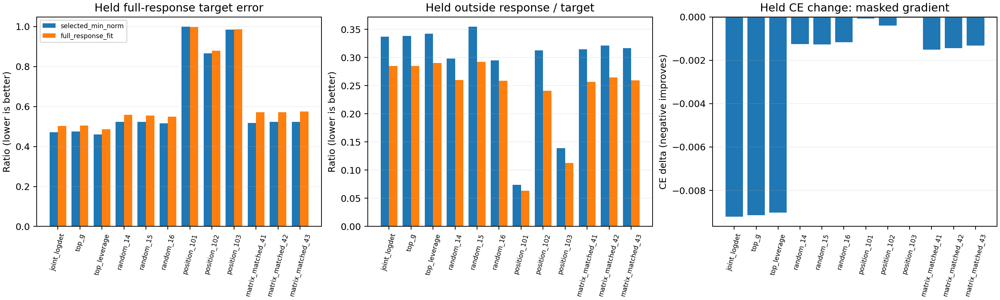

# 实验 B：单任务 DTD 的原始坐标集合可控性

2026-11-14，A100 已完成12种等预算集合的384次响应控制、72次任务梯度干预，服务正常退出（0）。依用户明确要求，本实验仍使用**旧 v5 第128步、固定 B10、单任务 DTD**，没有融合模型、跨任务冲突或 EC。每个干预都从同一个冻结锚点出发；没有连续训练或基底学习。

结果支持：**几何筛选出的原始坐标集合，在等参数预算和等任务步长下具有较高的局部 CE 控制效率**。但本次联合准则没有显示出超越简单 top-g / leverage 的独立优势；独立样本上的目标响应控制仍有明显误差与空间外副作用，不能宣称得到高保真、选择性的功能控制。

## 预设对照与独立检查

每个集合恰好849,346个不重复的原始坐标（名义1%），已读回掩码核验。集合选择和响应拟合用 Xprime 前128张；独立控制检查用 Xprime 最后256张，后者与实验 A 的两批128图都分离。两批64张训练图只提供任务梯度。样本名单、源 SHA、基座/头和基底身份记录在 config.json，分离与预算核验见 mask_audit.json。没有打开官方 Test。

12种集合为：

- `joint_logdet`：以 H_i=(FB)_i C^(-1/2) 的联合信息覆盖为准则，16批贪心近似选择；不是精确最优解，也不是发现16个组。
- `top_g`、`top_leverage`：明确的分数排序对照。
- 三个全坐标均匀随机集合。
- 三个位置对照：随机顺序选完整矩阵，最后一个矩阵截断到相同坐标数。这不是穷尽所有按层或矩阵方法的最强对照。
- 三个同矩阵配额随机集合：每个原矩阵内的坐标数量与联合候选完全相同，仅随机化具体位置。

联合候选与 top-g 坐标名单交集为80.61%，与 top-leverage 为59.79%。它们并非同一集合，但高度重合也限制了独立机制解释。真实模型干预用于检验这些候选，**不以分数高直接证明可控性**。

## 1. 实际目标预测响应控制

目标为真实模型 theta128+B*c*epsilon，c 是四个预设随机种子的单位向量，epsilon=0.001/0.003，各测正负。四个方向只是抽样目标，不代表覆盖了所有十维控制方向。两种控制器都只改变集合内的原始参数：

1. `selected_min_norm`：最小参数范数匹配所选功能投影，代数解为 H_G(H_G^T H_G)† C^(1/2)c*epsilon。
2. `full_response_fit`：在同一掩码访问方向张成范围内，使用实际 JVP 拟合完整目标响应，并加尺度相对1e-6的参数范数正则，以约束空间外影响。

两者均设参数范数上限0.01，先求解再截断。上限相同不意味着实际步长相同。第二种控制器也没有探索掩码内全部849,346维的最优干预；它只在10个掩码访问方向张成范围内求解，不能据失败证明集合本身无法控制。

下表取 epsilon=0.003，每行均值覆盖四个目标及正负号；三种随机对照进一步平均三个种子。所有原始半径、种子、符号和两种控制器都保留，未按独立检查结果选最佳配置。

| 集合 | 独立完整目标误差：selected-min-norm | 独立完整目标误差：full-response-fit |
|---|---:|---:|
| 联合候选 | 0.4724 | 0.5024 |
| top-g | 0.4752 | 0.5054 |
| top-leverage | 0.4613 | 0.4872 |
| 随机坐标，3种子均值 | 0.5216 | 0.5541 |
| 位置对照，3种子均值 | 0.9495 | 0.9545 |
| 同矩阵配额随机，3种子均值 | 0.5221 | 0.5732 |

完整目标误差是 ||DeltaPhi_control-DeltaPhi_target|| / ||DeltaPhi_target||，不是“未保留的方差比例”。

联合候选的 selected-min-norm 在拟合图上，所选响应误差约 **0.53%**，但在独立图上增至 **33.01%**；独立完整目标误差约 **47.24%**，空间外响应/目标响应范数约 **33.69%**，目标到控制模型 KL 约 **1.2206e-4**。拟合命中不等于泛化命中。

full-response-fit 把独立空间外比值降至 **28.46%**，却将所选目标误差提高到 **41.28%**、完整目标误差提高到 **50.24%**。这是本配置下的目标保真度与副作用之间的权衡，没有同时解决两者。

联合候选平均参数范数约0.001498，随机坐标约0.00978–0.00991，后者部分目标触发0.01上限。半径0.001时随机控制不受这一大步目标截断影响，联合候选的独立完整误差仍约0.4722，随机均值约0.5124：不能把全部差异归因于范数截断。不同集合控制相同目标所需参数量存在差异，但本轮没有证明联合候选优于 top-leverage。

## 2. 真正的任务 CE 干预

另使用两批训练梯度 g，只保留集合内分量，然后归一化施加 -epsilon*M_Gg/||M_Gg||。参数半径0.001、0.003、0.01在所有集合间相同。这里没有为了命中预测目标再拟合系数，真实模型在独立256张图上计算 CE。

以下为半径0.003的独立 CE 变化（负数表示改善）；随机类汇总两批梯度与三个种子：

| 集合 | CE 平均变化 |
|---|---:|
| 联合候选 | **-0.009204** |
| top-g | -0.009141 |
| top-leverage | -0.009017 |
| 随机坐标 | -0.001231 |
| 位置对照 | -0.000160 |
| 同矩阵配额随机 | -0.001425 |

同矩阵配额随机仍弱于候选，说明这个局部现象不完全由“选中了哪些矩阵、每个矩阵选多少”解释。联合候选对比简单 top-g 的差异很小（约6.3e-5），仅有两批共享梯度和一个锚点，**不主张联合准则有独立优势**。

72项记录的 CE 变化均为负，但某些位置对照仅为1e-8–1e-6量级，接近数值噪声；这些记录共享图像、梯度和状态，也不是72次独立统计重复。这里只报告固定样本上的局部数值结果。

联合候选在0.003下平均 KL(base||control)约 **6.54e-4**，随机坐标约1e-5量级。因此这里的优势是**等参数预算、等参数范数下的控制效率**，不是等预测 KL 下的任务效率优势。联合候选任务干预的有限预测响应中，约 **55.46% 的平方能量落在所选 R=JB 之外**，不能把 CE 收益全归因于十维内部功能。空间外变化需要报告，不自动等于有害副作用。

## 能支持什么

1. 当前几何确实能产生部分有效的原始坐标候选，并通过真实参数干预获得较好的局部任务下降；不只是画了一张分数图。
2. 参数表示、访问、实际更新对齐是不同量；它们也没有自动给出唯一、必要的功能承载集合。
3. 当前独立目标响应控制有明显泛化误差与外部响应，尚未实现高保真、低外溢的功能局部控制。
4. 本轮不能证明联合选择优于简单分数排序，不能证明天然功能分组，更不涉及跨任务冲突、Pareto 或 EC。

局限是单一1%预算、单一旧锚点、四个随机目标方向、两批相关梯度，以及受限的控制器方向范围。没有将这些原始坐标集合用于连续训练，也没有声称恢复82%专家性能。下一阶段若要求更强结论，需扩大独立样本与状态，并比较允许更充分掩码自由度、明确限制空间外影响的控制器。

## 溯源与恢复

输出 `/media/shangxueyuan/data1/DTD_fixed10_control_20261114`。private/ 保留真实掩码、梯度和响应算子，controls/ 逐方法保存完整 JSON。公开 config、所有控制记录、summary、mask_audit、图和源码；不上传原始掩码、权重或逐图响应数组。

源码哈希已与实际执行 config 核验；读回检查12个掩码的不重复预算、同矩阵配额、样本分离、384/72记录数量以及扰动范数。3项求解器测试验证最小范数解、范数上限与未选坐标不变、秩亏时不虚报完全命中。A 与 B 两个服务均正常完成。没有进行实际中断重放测试；缓存和已完成方法允许继续，写入中断的缓存需校验。

assets.json 是冻结适配器的初始化元数据，其中旧算法标签不描述本实验；以 SUPPORT_PROTOCOL.md、config.json 和本报告为准。
