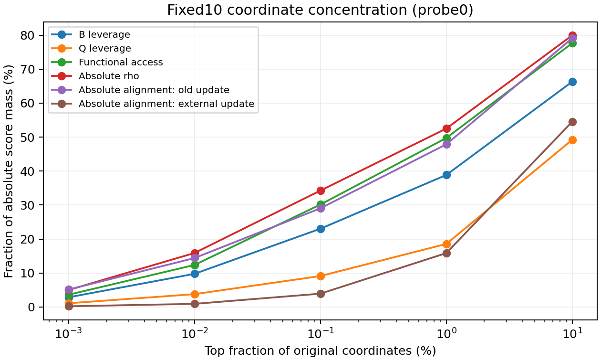
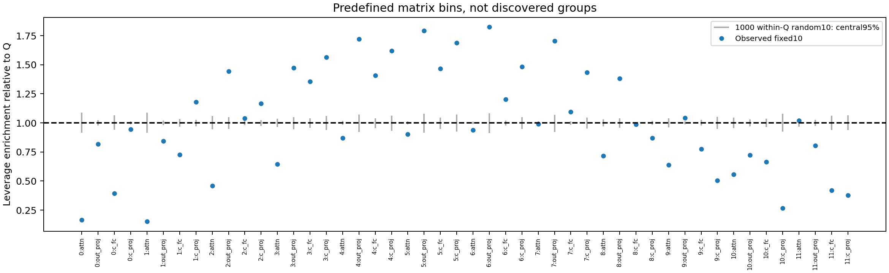
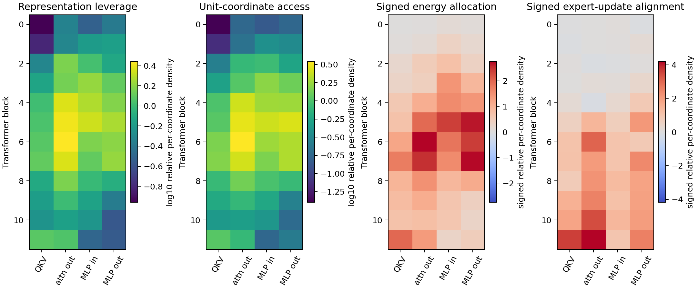
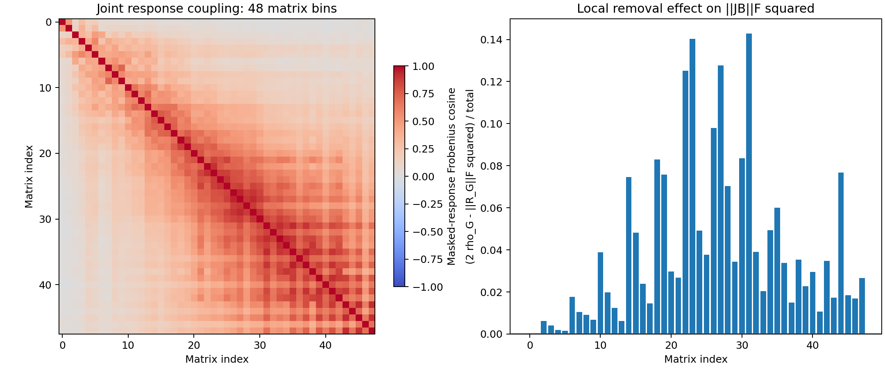

# 实验 A：固定十维的欧氏承载、访问与联合响应

2026-11-14，A100 实测完成，服务正常退出（0）。沿用旧 v5 第128步和固定 B10，只分析单任务 DTD；未训练、未修改方向、未使用融合模型或 EC。

## 协议与指标

两批不重叠的 Xprime128 图像分别计算 J、FB、C=B^T FB。它们未参与原 B 的方向选择，但过去被用于其他评估，不是此前完全未打开的新数据。全部活动空间为48个视觉权重矩阵、D=84,934,656。其余参数及头固定。

- ell_i：B 行范数平方，表示原始坐标的子空间参与度。
- g_i：(FB)_i C† (FB)_i^T，表示单位原始坐标扰动对所选功能响应的访问强度。它依赖参数尺度，不等于任务重要性。
- rho_i：B_i 与 (FB)_i 内积，是带符号的 Fisher 二次能量分配，不是特征值形成的因果贡献。
- a_i：指定实际更新的投影响应对齐分解。分别用旧 v5 终点位移和82%专家终点位移，均相对 theta0、限制在48矩阵内，在同一个旧 theta128 锚点做局部分析；不把大位移的一阶响应当成真实有限更新性能。

检查 sum ellB=10、sum ellQ=26、sum rho=tr C、sum a=1。所有负值保留，不把这些分数组合成一个 importance score。伪逆相对阈值1e-10，本次两批 C 均保留10维。

## 参与位置与访问位置有差异，但不是普遍分离

第一批图像，按每项自身绝对值排序的前1%坐标，集中：

| 分布 | 前1%所占绝对总量 |
|---|---:|
| B10 leverage | 38.85% |
| Q26 leverage | 18.55% |
| 单位坐标访问 g | 49.73% |
| rho 绝对值 | 52.50% |
| 旧 v5 更新 a 绝对值 | 47.87% |
| 外部专家更新 a 绝对值 | 15.86% |

这是浓度描述，不是“这些坐标足以保留上述比例的功能”。尤其 a/rho 有抵消，绝对值集中度不等于净贡献或删除效果。

ellB 前1%与 g 前1%名单的交集占各自名单 **53.58%**，Jaccard为0.3659。两者不同，但“未进入 leverage 前1%”不等于 leverage 非常低。

更严格地，要求 ellB 低于全坐标中位数、同时 g 进入全坐标前1%：第一批有 **1467** 个，仅占 g 前1%名单的0.173%；其中只有 **8个**在第二批仍进入 g 前1%。这支持少量可复现例子的存在，**不支持发现了大规模稳定的低参与、高访问群**。筛选阈值只是诊断规则，不是功能必要性的判据。

一个双批次复现例子（索引均从0开始）：全局坐标40,078,162，`resblocks.5.mlp.c_fc.weight[3033,82]`；ellB=1.7396e-8，小于中位数3.0602e-8；两批 g 分别0.0034900、0.0023458。全部8个例子及矩阵坐标在 aggregate_audit.json 中。未对这8个坐标逐一做真实模型因果干预，不能单凭例子称其必要或不可替代。

## 相对 Q 的富集

E_i=ellB_i / ((10/26)ellQ_i)，只在 ellQ_i>1e-20 处定义，本次84,934,600个坐标有效。范围约1.81e-7到2.599999，中位数0.9051，99%分位2.5992；理论上界2.6。按 ellQ 加权的均值约1，是总 leverage 的恒等式结果，不能当成额外证据。

固定非零 Q 行，在 Q 内取 Haar 随机十维时 E/2.6 ~ Beta(5,8)。其95%阈值1.583758；观测35.43%的有效坐标超过该边际阈值，但坐标高度相关，**没有进行 IID 坐标显著性检验**。48个矩阵汇总另使用1000次共享 Haar 随机子空间参考和 Holm 校正；第一批21个矩阵上尾调整 p<0.05。这里只检验相对随机候选子空间的偏离，不证明任务收益或方法创新。

## 联合响应与非对角耦合

对48个预设原矩阵 G，实际计算 R_G=J M_G B，并构造 Gamma_GH=<R_G,R_H>F。它们是汇总分箱，**不是学出来的48个功能组**。方向删除后不重归一化、不重选 B。

第一批总响应能量约 **1152.43**；矩阵自响应能量之和 **82.57**；跨矩阵交叉项之和 **1069.86**，约占总量 **92.8%**。不相交掩码之间的这些交叉项确实来自 Fisher 的跨坐标块耦合，但比例依赖所选划分，不能直接称作任务协同收益。1128个无序矩阵对中6对交叉项为负。

逐组验证 Delta_G=||R||F²-||R-R_G||F²=2rho_G-||R_G||F²。48个矩阵删除量本次均为正；逐坐标 rho 则有负值，其负值绝对量占总绝对量约9.65%。聚合会隐藏抵消。

sum R_G 与直接 JB 的相对误差为5.08e-7；rho 的 VJP 与 masked-JVP 两种算法相对误差约1.33e-7。它们验证实现一致性，不验证形成因果或 CE 删除效果。

## 重复性：矩阵稳定不等于坐标稳定

| 指标 | 两批逐坐标 Pearson | 两批矩阵和 Pearson | 前1%交集比例 |
|---|---:|---:|---:|
| g | 0.7895 | 0.9874 | 57.31% |
| rho | 0.8664 | 0.9907 | 62.70% |
| 旧更新 a | 0.7992 | 0.9879 | 52.30% |
| 外部专家更新 a | 0.2185 | 0.9446 | 26.02% |

前1%对带符号指标按绝对值选择。这是固定锚点的两批图像重复性，不是跨状态或跨任务稳定性。尤其外部专家 a 的逐坐标分配不稳定，不能仅凭高矩阵相关便声称找到了稳定的原始参数子集。

## 复核与下一步

实际模型可控性由[实验 B](../20261114_control/REPORT.md)单独验收，不能从这些分数或能量恒等式直接推出。B 已按用户明确要求改为单任务 DTD，不使用融合模型；A 原始 config/report 中启动时关于“等待融合锚点”的行政标签被 SUPPORT_PROTOCOL.md 和 aggregate_audit.json 的范围修订说明替代。

完整输出 `/media/shangxueyuan/data1/DTD_fixed10_support_20261114`。FB、逐坐标分数和原始响应保留在 private/；公开的是全部聚合 JSON、例子、Gamma 和四张图。执行源 SHA、基底 SHA、基座/头、参数偏移、两批图像 ID 见 config.json，源码哈希与提交文件一致。3项专门数学测试验证支撑与访问可分离、四指标的正交旋转不变性、带符号删除效果。

恢复粒度为已完成矩阵/探测批次；本次没有实际中断重放测试。未完成的写入缓存需要校验，不能把“存在缓存”称作经过验证的完整恢复保障。
