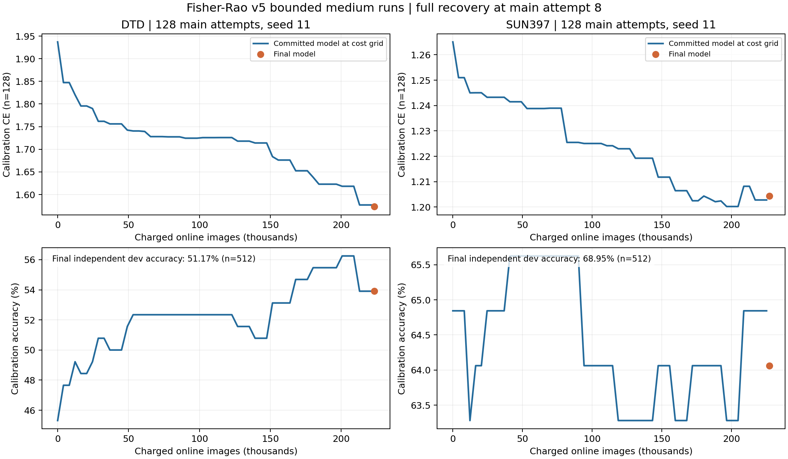

# Fisher–Rao v5：DTD 与 SUN397 中程结果

两个任务均完成累计 128 次主坐标尝试，并从各自第 8 步的完整检查点实际重启接续。源码为 `98f36a1b5135bce79be21b46e0024c22629d683d`，保持已接受的 `71bb08d` 求解与几何提议规则，仅增加任务适配、数值监控和完整历史恢复。46 项测试在本机与 A100 主机通过。两任务各自的经验商空间、字典、坐标和数据独立，没有融合或跨任务分簇。

这是中程稳定性与恢复验证，**不是百万预算长训或收敛性能验收**。没有自动启动百万预算训练，也没有开启官方测试集。

## 性能

Vcal 为 128 张校准样本；Xprime 为另一组 512 张独立开发样本。独立基座参照在训练完成后只读计算，与最终模型使用同一批 ID，计费和训练分开记录。Vcal 选定模型按固定成本网格上的最低 CE 选择，因此与非网格上的最终模型可能不同；Xprime 不决定在线方向或模型选择。本轮只有一个训练种子与有限开发样本，不据此主张统计显著性或跨种子稳定收益。

| 任务 | 模型 | Vcal CE | Vcal accuracy | Xprime CE | Xprime accuracy |
|---|---|---:|---:|---:|---:|
| DTD | 基座 | 1.937107 | 45.31% | 2.036753 | 45.70% |
| DTD | 最终模型 | 1.573537 | 53.91% | 1.739551 | 51.17% |
| DTD | Vcal CE 选定模型 | 1.576986 | 53.91% | 1.741330 | 51.56% |
| SUN397 | 基座 | 1.265071 | 64.84% | 1.221920 | 67.38% |
| SUN397 | 最终模型 | 1.204410 | 64.06% | 1.113304 | 68.95% |
| SUN397 | Vcal CE 选定模型 | 1.200222 | 63.28% | 1.118063 | 68.95% |

图中主曲线仅来自已提交模型的固定成本网格；橙点是最终模型。在线计费含主训练、真实 JVP、候选、失败提议及两条前瞻分支，不等于等 FLOPs。绝对准确率不应用来直接比较两个不同任务的难度。

## 数值、恢复与结构

### DTD

- 主坐标尝试 128 次，接受 124 次；求解器回退 0 次，几何事务回滚 0 次。
- 历史 CKPT 共 17 份，0、8、16、…、128 步全部保留；从第 8 步真实重启，坐标恢复误差 1.73e-18。
- 约化系统条件数范围 1.335–3.281；最小保留奇异值 0.000474078；坐标范数最大 39.877。
- 参数步重构相对误差最大 5.96e-14，坐标累加误差最大 5.98e-16。
- 最终字典 5 维、数值参数秩 5（rtol=1e-8；机器精度秩为 5）、8 个坐标、5 个组；几何窗口 18 次。
- 跨窗口结构分类：`{"insufficient_history": 2, "diverse_recurrence": 16}`。
- 在线计费图像 223328；训练段累计耗时 29.30 分钟（含保存，不含排队与模型初始加载）；报告的恢复段 PyTorch 分配显存峰值 14.76 GiB。
- 训练结束后只读检查最终字典的一条方向：中心差分预先声明主步长 0.003，相对误差 0.00233936、余弦 0.999997285，满足预先声明的 0.02 / 0.999 阈值。[完整 JVP 记录](../medium_DTD/final_jvp_verification.json)另记诊断成本，不冒充全方向或全轨迹证明。
- [原始报告](../medium_DTD/report.json)、[数值及历史断点验收](../medium_DTD/medium_verification.json)、[逐步事件](../medium_DTD/coordinate_events.json)、[几何事件](../medium_DTD/geometry_events.json)、[数据追溯表](../medium_DTD/main_training_data_trace.json)。

### SUN397

- 主坐标尝试 128 次，接受 124 次；求解器回退 0 次，几何事务回滚 0 次。
- 历史 CKPT 共 17 份，0、8、16、…、128 步全部保留；从第 8 步真实重启，坐标恢复误差 0。
- 约化系统条件数范围 2.384–4.854；最小保留奇异值 1.2768e-09；坐标范数最大 2.70183e+06。
- 参数步重构相对误差最大 1.07e-08，坐标累加误差最大 2.91e-10。
- 最终字典 5 维、数值参数秩 4（rtol=1e-8；机器精度秩为 4）、8 个坐标、2 个组；几何窗口 20 次。
- 跨窗口结构分类：`{"insufficient_history": 4, "diverse_recurrence": 15, "no_beneficial_outside_residual": 1}`。
- 在线计费图像 227328；训练段累计耗时 32.36 分钟（含保存，不含排队与模型初始加载）；报告的恢复段 PyTorch 分配显存峰值 12.57 GiB。
- 训练结束后只读检查最终字典的一条方向：中心差分预先声明主步长 0.003，相对误差 0.00597706、余弦 0.999982148，满足预先声明的 0.02 / 0.999 阈值。[完整 JVP 记录](../medium_SUN397/final_jvp_verification.json)另记诊断成本，不冒充全方向或全轨迹证明。
- [原始报告](../medium_SUN397/report.json)、[数值及历史断点验收](../medium_SUN397/medium_verification.json)、[逐步事件](../medium_SUN397/coordinate_events.json)、[几何事件](../medium_SUN397/geometry_events.json)、[数据追溯表](../medium_SUN397/main_training_data_trace.json)。

## 可以与不可以得出的结论

中程运行表明：修复后的约化求解器可以接续真实任务更新；完整检查点能恢复局部几何、持续性历史、随机数、预算、报告与选优状态。全部历史快照留在 A100 数据盘，Git 保存其索引、代码和 JSON 证据，不上传多 GB 权重。

**SUN397 实际出现了预警的近相关坐标放大**：最小保留奇异值约 1.28e-9，坐标范数最大约 2.70e6、其中位数约 3.46e5。参数步重构最大相对误差约 1.07e-8，坐标累加误差最大约 2.91e-10；没有非有限参数或求解器回退，但这不能证明长期抵消安全。DTD 坐标范数最大约 39.88，也记录为后续监控项。

审计中的 `engineering_medium_checks_passed` 仅覆盖源码、断点恢复、有限且可重构的参数步、无回退/回滚及历史快照覆盖；**它不是坐标幅度安全或百万长训的放行结论**。原始机器精度截断和训练轨迹没有在事后被修改，也没有悄悄修正最终坐标。两任务的最终/历史状态完整保留，百万长训尚未启动；应先审查 SUN397 的近重合方向与坐标抵消再决定继续策略。

坐标优化由组的联合空间控制；组划分影响后续几何提议。保持联合空间不变的合并可以仅因复杂度项而被接受，不能解释为发现了功能耦合。字典、组和有效秩变化也不等于多个组已具有独立、可控制的功能。稳定复现、同总秩单组与随机分组对照仍是后续机制实验。

划分沿用已有镜像与冻结 manifest，探测样本取自训练池并从优化池排除。官方折号来源尚未独立核验；没有把官方测试集用于启动条件或报告。

## 断点与数据追溯

服务 `fisher-rao-v5-two-task-medium-20261112.service` 以用户级 systemd 顺序执行两任务，最终状态见 [队列记录](queue_final.json)及[服务退出记录](service_exit.txt)。

输出目录为 `/media/shangxueyuan/data1/fisher_rao_online_v5_{DTD|SUN397}_medium_seed11_98f36a1_20261112`。历史快照在 `checkpoints/step_步数_images_累计图像数.pt`，`recovery_state.pt` 是最新恢复入口。保留冻结源码目录 `/home/shangxueyuan/merging/tsv/scripts/fisher_rao_online_v5_98f36a1`；恢复要求相同源码、基座、头、划分、设置、预算及报告网格。

主训练数据追溯表由冻结代码的 seed、迭代数、训练池和 manifest 确定性重建，明确属于事后重建，未冒充单独的实时 ID 日志；含相对路径、样本 ID 和增强种子。几何候选及独立确认批次 ID 已直接记录在几何事件中。完整检查点还保存候选持续性历史及随机数状态。

硬中断可恢复到最近已提交快照；快照后丢失的计算会重放，不属于恢复账本中的已计费工作。该限制已记录，不能将恢复预算解释为包含所有失效进程浪费的物理总成本。
