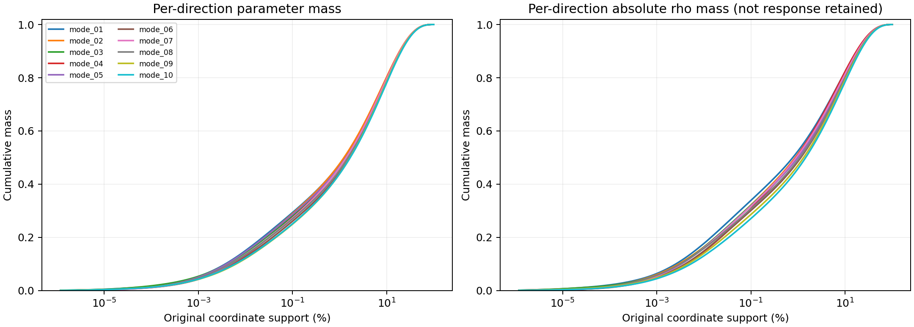
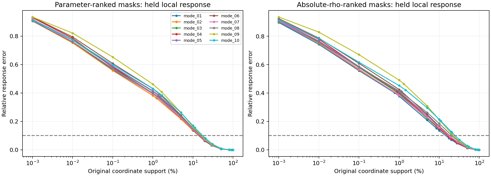
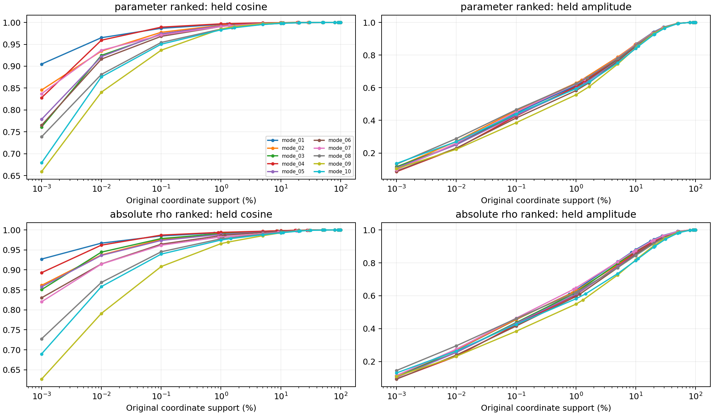
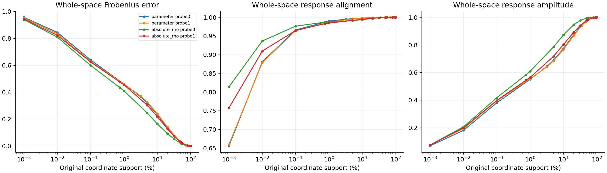

# Fisher Subspace Support Profile

2026-11-14，A100 完成。分析现有输入空间，维数由文件读取；没有重新选择十维、没有固定1%预算、没有控制器拟合或连续训练。

活动坐标 D=84,934,656，输入空间维数 r=10，旧 v5 第128步；两批独立开发图各128张。
逐方向名称按历史平均受限 Fisher 的特征值降序排列。留一历史状态算子后的单方向绝对余弦最小值范围为 0.9650–0.9987。这只是该扰动下的稳健性检查，近谱值方向仍需谨慎解释；整体指标对正交基底旋转不变。

## 参数质量与绝对 Fisher 分配的支持比例

完整排序累计曲线直接反求所需坐标数，以下百分比是该排名下的精确质量阈值。绝对 rho 质量不是功能响应保留率。

| 对象 | 排名 | 50%质量所需 | 80%质量所需 | 90%质量所需 | 95%质量所需 | 99%质量所需 |
|---|---|---:|---:|---:|---:|---:|
| mode_01 | parameter | 1.262% | 10.085% | 19.239% | 28.952% | 50.246% |
| mode_01 | absolute_rho | 0.775% | 8.525% | 17.602% | 27.639% | 50.250% |
| mode_02 | parameter | 1.238% | 9.784% | 18.795% | 28.442% | 49.776% |
| mode_02 | absolute_rho | 0.870% | 8.854% | 18.051% | 28.171% | 50.828% |
| mode_03 | parameter | 1.407% | 10.421% | 19.665% | 29.466% | 50.895% |
| mode_03 | absolute_rho | 0.920% | 8.913% | 18.114% | 28.250% | 51.000% |
| mode_04 | parameter | 1.383% | 10.131% | 19.210% | 28.909% | 50.301% |
| mode_04 | absolute_rho | 0.900% | 8.546% | 17.422% | 27.348% | 49.998% |
| mode_05 | parameter | 1.371% | 10.446% | 19.707% | 29.474% | 50.779% |
| mode_05 | absolute_rho | 0.989% | 9.609% | 19.156% | 29.464% | 52.198% |
| mode_06 | parameter | 1.640% | 10.978% | 20.281% | 30.068% | 51.404% |
| mode_06 | absolute_rho | 1.151% | 10.005% | 19.643% | 30.020% | 52.854% |
| mode_07 | parameter | 1.382% | 10.163% | 19.223% | 28.875% | 50.215% |
| mode_07 | absolute_rho | 0.914% | 9.089% | 18.351% | 28.513% | 51.300% |
| mode_08 | parameter | 1.537% | 10.885% | 20.292% | 30.152% | 51.509% |
| mode_08 | absolute_rho | 1.091% | 9.985% | 19.660% | 30.048% | 52.833% |
| mode_09 | parameter | 1.667% | 10.833% | 20.007% | 29.704% | 51.012% |
| mode_09 | absolute_rho | 1.315% | 10.522% | 20.262% | 30.647% | 53.382% |
| mode_10 | parameter | 1.683% | 11.116% | 20.509% | 30.363% | 51.714% |
| mode_10 | absolute_rho | 1.457% | 10.975% | 20.903% | 31.422% | 54.232% |
| whole_subspace | parameter | 3.206% | 20.616% | 34.431% | 46.601% | 68.654% |
| whole_subspace | absolute_rho | 0.746% | 10.027% | 20.496% | 31.569% | 54.713% |

正负分配项另列如下；负值不删除，正负分配不能直接解释成任务促进或冲突。

| 对象 | 正 rho 总量 | 负 rho 总量 |
|---|---:|---:|
| mode_01 | 306.806 | -93.125 |
| mode_02 | 237.472 | -82.6224 |
| mode_03 | 217.671 | -71.7201 |
| mode_04 | 332.037 | -122.844 |
| mode_05 | 168.428 | -58.5715 |
| mode_06 | 127.16 | -47.4936 |
| mode_07 | 169.501 | -66.1298 |
| mode_08 | 99.5984 | -43.793 |
| mode_09 | 79.2653 | -34.1516 |
| mode_10 | 71.5881 | -36.6475 |
| whole_subspace | 1290.19 | -137.766 |

## 原方向 mask 的直接局部响应

掩码后不重归一化，不优化系数，直接计算 J M_G b 或 J M_G B。rho 排名只使用第一批，第二批使用完全相同的 mask。
E 是相对响应残差，A 是余弦，N 是幅值比。所谓90%响应标准在这里明确指 E≤0.10，不是能量保留90%。
以下是已测嵌套排名路径上的最小达标点；支持点包含预设的宽范围网格及每条质量曲线反求出的质量阈值。未假设响应误差单调，也未声称找到全局最小支持；数据分辨率之外的最小值尚未确定。

| 对象 | 排名 | 独立 E≤0.20 | 独立 E≤0.10 | 独立 E≤0.05 | 独立 E≤0.01 |
|---|---|---:|---:|---:|---:|
| mode_01 | parameter | 10.000% | 19.239% | 28.952% | 50.000% |
| mode_01 | absolute_rho | 8.525% | 17.602% | 27.639% | 80.000% |
| mode_02 | parameter | 9.784% | 18.795% | 28.442% | 49.776% |
| mode_02 | absolute_rho | 8.854% | 18.051% | 28.171% | 80.000% |
| mode_03 | parameter | 10.000% | 19.665% | 29.466% | 50.000% |
| mode_03 | absolute_rho | 8.913% | 18.114% | 50.000% | 80.000% |
| mode_04 | parameter | 10.000% | 19.210% | 28.909% | 50.000% |
| mode_04 | absolute_rho | 8.546% | 17.422% | 49.998% | 80.000% |
| mode_05 | parameter | 10.000% | 19.707% | 29.474% | 50.000% |
| mode_05 | absolute_rho | 9.609% | 19.156% | 50.000% | 80.000% |
| mode_06 | parameter | 10.000% | 20.000% | 30.068% | 50.000% |
| mode_06 | absolute_rho | 10.000% | 19.643% | 50.000% | 80.000% |
| mode_07 | parameter | 10.000% | 19.223% | 28.875% | 50.000% |
| mode_07 | absolute_rho | 9.089% | 18.351% | 50.000% | 80.000% |
| mode_08 | parameter | 10.000% | 20.000% | 30.152% | 50.000% |
| mode_08 | absolute_rho | 9.985% | 30.048% | 50.000% | 80.000% |
| mode_09 | parameter | 10.000% | 20.000% | 29.704% | 50.000% |
| mode_09 | absolute_rho | 20.000% | 30.647% | 50.000% | 80.000% |
| mode_10 | parameter | 10.000% | 20.000% | 30.363% | 50.000% |
| mode_10 | absolute_rho | 20.000% | 31.422% | 50.000% | 80.000% |
| whole_subspace | parameter | 20.000% | 34.431% | 46.601% | 68.654% |
| whole_subspace | absolute_rho | 20.000% | 31.569% | 50.000% | 80.000% |

## 边界与溯源

这些是固定锚点的 JVP 一阶响应，不是有限参数步的真实 CE 或准确率验收。参数质量集中、绝对 rho 集中、功能响应保持必须分开。整体 Frobenius 误差按响应能量加权，不等于所有方向或任意线性组合的最坏相对误差；原始记录另存共同 mask 下的逐列误差。曲线只能说明所测排名路径上的承载分布，不能证明参数子集唯一或不可替代，也不能称为跨任务冲突模式。
输入仍为旧轨迹产生的空间，不是全参数 Fisher 自动发现结果。无明显间隙或对扰动不稳的单方向不能推广为天然功能原子；本次不强行构造新功能分组。
源码哈希与执行 config 一致。每个支持点单独原子保存 JSON，完整排序索引保存在服务器 private/，不公开模型权重或排序坐标。中断后按已完成支持点继续；本轮未做中断重放验收。
assets.json 是冻结适配器的初始化记录，其中初始 X 等标签不是本次观测集；实际观测样本以 config.probes 为准，两批均来自未参与方向选取的独立开发样本。
输出目录 `/media/shangxueyuan/data1/DTD_fisher_support_profile_20261114`。本实验取代此前固定1%控制作为当前研究对象，旧结果保留。

恢复说明：初版在全部20条逐方向曲线完成后，于整体分数的向量化表达式处发生 CUDA invalid configuration argument。保留 run_initial.py 和原目录；新版本逐列等价累加分数，读取旧曲线并仅补算整体曲线。每条 profile 记录其实际执行版本 SHA。最终目录为 `/media/shangxueyuan/data1/DTD_fisher_support_profile_20261114_r2`。

## 本次结果的解释

- 单方向95%参数质量所需支持比例为28.44%–30.36%，没有从这些曲线强行划出 localized/distributed 两类。整体共同 mask 的95%参数质量需要46.60%。
- 整体95%绝对 rho 质量需要31.57%坐标，但该点独立响应残差为7.31%。归因累计量不能替代响应验收。
- 参数排名的相对响应误差与归因排名必须在第二批图像上比较；排名样本上的改善不自动泛化。严格阈值下，绝对 rho 排名没有表现出一致的独立优势。
- 整体参数质量是共同 mask 的结果，逐方向各自支持集合则可以不同；不能将方向维数当作原坐标支持数，也不能将两种支持实验混成固定预算控制。
